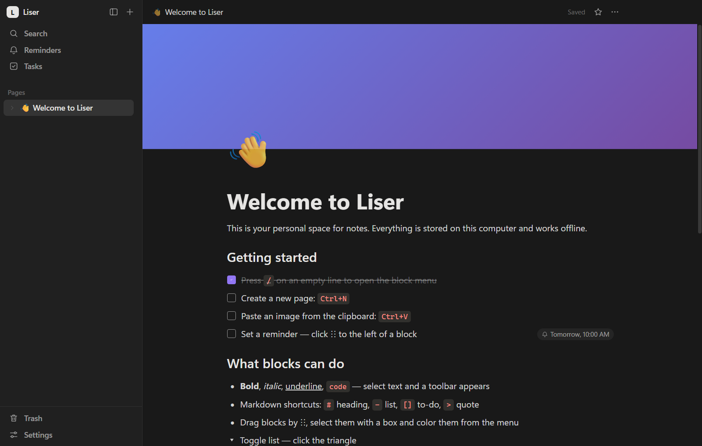
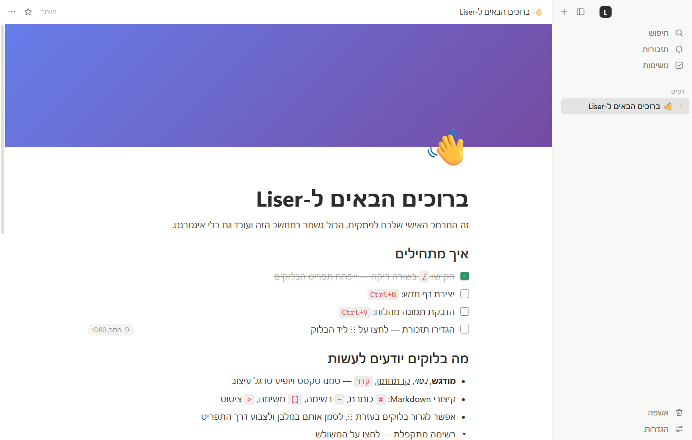

<p align="center">
  
</p>

<h1 align="center">Liser</h1>

<p align="center">
  Offline notes for Windows: blocks, to-dos, reminders and drawing.<br>
  Everything stays on your computer.
</p>

<p align="center">
  <a href="README.md">Русский</a> · <b>English</b>
</p>



## Features

- **Block editor**: text, headings, to-do lists, bulleted and numbered lists, toggle lists, quotes, callouts, code, dividers, images, drawings and nested pages.
- **`/` menu** and Markdown shortcuts: `#` heading, `-` list, `[]` to-do, `>` quote, `>>` toggle, ```` ``` ```` code.
- **Reminders** with date, time and repeat (daily / weekly / monthly / yearly), native Windows notifications and snooze. They keep working from the tray.
- **Linked pages**: select a word and press “Page” on the toolbar (`Ctrl+Shift+K`), or type `[[`. Hovering a link previews the page, and each page lists its backlinks and unlinked mentions at the bottom.
- **Graph view** (`Ctrl+G`): a map of all pages and the links between them, with zoom, pan, search and a per-page local graph.
- **Tasks** from every page in one view; **reminders** grouped by due date.
- **Drawing** with pen, highlighter and eraser, including on top of images. Strokes are vector, so they stay sharp at any zoom.
- **Images**: paste with `Ctrl+V`, drag & drop, resize, captions.
- **Styling**: covers, page icons, block text and background colors, three fonts, full-width pages.
- **Search** across all notes (`Ctrl+P`) and within a page (`Ctrl+F`).
- **Themes**: light, dark and system, 7 accent colors, interface scaling.
- **Languages**: Russian, English and Hebrew with a fully mirrored right-to-left interface. Text direction is detected per paragraph, so notes can mix languages.
- **Your data**: autosave, daily automatic backups, manual backup and restore, export to Markdown and PDF.



## Install

Download `Liser-Setup-<version>.exe` from [Releases](../../releases) and run it. The installer lets you pick a folder and creates desktop and Start menu shortcuts. Uninstall from Settings → Apps.

**Updating**: just run the newer installer. It detects the installed version, shows old → new, and offers an “Update” button. The app is updated in place; notes and settings are untouched.

> The installer isn't code-signed, so Windows SmartScreen may warn on first run: “More info → Run anyway”.

Notes are stored in `%APPDATA%\Liser\data` — one JSON file per page, images in the `assets` folder next to them.

## Development

Requires [Node.js](https://nodejs.org) 20+.

```bash
npm install
npm start            # run the app
npm run web          # open the UI in a browser (data in localStorage)
npm run check        # syntax and translation completeness check
npm run dist         # build the installer into dist/
```

GitHub Actions builds on every push; pushing a `v*` tag publishes the installer to Releases.

The UI is plain JavaScript with no framework or bundler: modules load directly, so the window opens fast and the installer contains only Electron plus the sources.

## License

[MIT](LICENSE)
