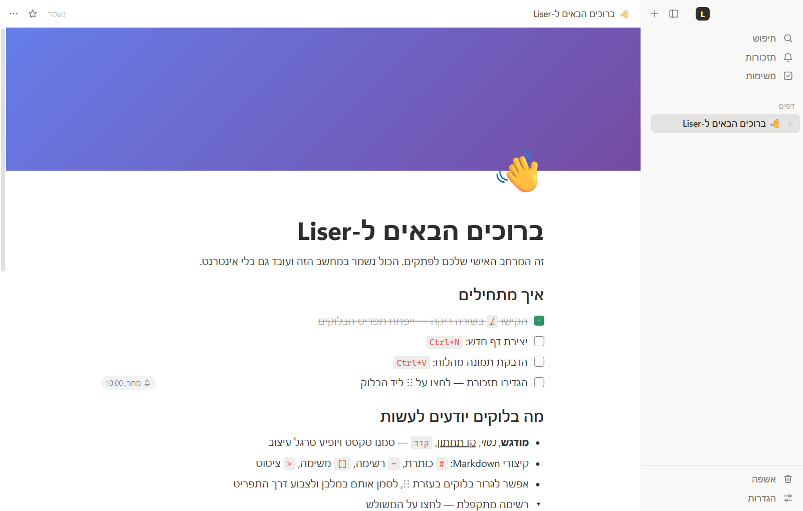

<div dir="rtl">

<p align="center">
  
</p>

<h1 align="center">Liser</h1>

<p align="center">
  פתקים ללא חיבור לאינטרנט ל-Windows: בלוקים, משימות, טבלאות, קוד, תזכורות וציור.<br>
  הכול נשמר רק במחשב שלכם.
</p>

<p align="center">
  <a href="README.md">English</a> · <b>עברית</b> · <a href="README.ru.md">Русский</a>
</p>

<p align="center">
  <a href="https://github.com/polkakoch/liser/releases/latest/download/Liser-Setup.exe"><b>⬇ הורדת Liser ל-Windows</b></a>
</p>



## מה יש ב-Liser

- **עורך בלוקים**: טקסט, כותרות, רשימות משימות, רשימות עם תבליטים וממוספרות, רשימות מתקפלות, ציטוטים, הערות בולטות, קוד, טבלאות, קווים מפרידים, תמונות, ציורים, תוכן עניינים ודפים פנימיים.
- **תפריט `/`** וקיצורי Markdown: `#` כותרת, `-` רשימה, `[]` משימה, `>` ציטוט, `>>` רשימה מתקפלת, ```` ``` ```` קוד — וגם Markdown תוך כדי הקלדה: `**מודגש**`, `*נטוי*`, `` `קוד` ``, `~~קו חוצה~~`.
- **קוד** עם הדגשת תחביר ל-22 שפות. השפה מזוהה אוטומטית או נבחרת ידנית, קטע קוד שמודבק הופך מיד לבלוק קוד, ויש כפתור העתקה.
- **טבלאות ומילון**: `/טבלה`, או `/מילון` לטבלת „מילה — תרגום” מוכנה ללימוד שפות. `Tab` — התא הבא, `Enter` — שורה חדשה, אפשר למיין עמודות ולשנות את רוחבן, וכל תא מזהה בעצמו את כיוון הטקסט. רשימות שהועתקו מ-Excel או מ-Google Sheets מודבקות ישר כטבלה.
- **קישורים בין דפים**: סמנו מילה ולחצו על „דף” בסרגל (`Ctrl+Shift+K`), או הקלידו `[[` או `@`. ריחוף מעל קישור מציג תצוגה מקדימה של הדף, ובתחתית כל דף מופיעים הדפים שמקשרים אליו ואזכורים ללא קישור.
- **גרף** (`Ctrl+G`): מפה של כל הדפים והקשרים ביניהם, עם הגדלה, גרירה, חיפוש וגרף מקומי לכל דף.
- **תזכורות** עם תאריך, שעה וחזרה (כל יום / שבוע / חודש / שנה), התראות של Windows וכפתור „נודניק”. ממשיכות לעבוד ברקע מהמגש.
- **משימות** מכל הדפים במסך אחד; **תזכורות** מקובצות לפי מועד.
- **ציור** בעט, במרקר ובמחק, גם מעל תמונה. הקווים נשמרים כווקטור ונשארים חדים בכל הגדלה.
- **תמונות**: הדבקה עם `Ctrl+V`, גרירת קבצים, שינוי גודל, כיתובים.
- **עיצוב**: תמונות שער, סמלים לדפים, צבעי טקסט ורקע לבלוקים, שלושה גופנים, דף ברוחב מלא.
- **חיפוש** בכל הפתקים (`Ctrl+P`) ובדף הנוכחי (`Ctrl+F`).
- **ערכות נושא**: בהירה, כהה ולפי המערכת, 7 צבעי הדגשה, הגדלת הממשק מ-50% עד 200%.
- **שפות**: עברית, אנגלית ורוסית, עם ממשק מלא מימין לשמאל. כיוון הטקסט נקבע לכל פסקה בנפרד, כך שאפשר לערבב שפות באותו פתק.
- **הנתונים שלכם**: שמירה אוטומטית, גיבוי אוטומטי יומי, גיבוי ושחזור ידניים, ייצוא ל-Markdown ול-PDF.

## התקנה

[הורידו את תוכנית ההתקנה](https://github.com/polkakoch/liser/releases/latest/download/Liser-Setup.exe) (תמיד הגרסה האחרונה) והפעילו אותה. גרסאות קודמות נמצאות ב-[Releases](../../releases). תוכנית ההתקנה מאפשרת לבחור תיקייה ויוצרת קיצורי דרך בשולחן העבודה ובתפריט „התחל”. הסרה — דרך „הגדרות ← אפליקציות”.

**עדכון**: פשוט הפעילו את תוכנית ההתקנה של הגרסה החדשה. היא מוצאת את Liser המותקן, מראה איזו גרסה מותקנת ואיזו תותקן, ומציעה כפתור „עדכון”. התוכנה מתעדכנת באותה תיקייה, והפתקים וההגדרות לא משתנים.

> תוכנית ההתקנה אינה חתומה בתעודת מפתח, ולכן בהפעלה הראשונה Windows SmartScreen עשוי להציג אזהרה: „מידע נוסף ← הפעל בכל זאת”.

הפתקים נשמרים ב-`%APPDATA%\Liser\data` — כל דף בקובץ JSON נפרד, והתמונות בתיקיית `assets` לידם.

## קיצורי מקלדת

| מקשים | פעולה |
| --- | --- |
| `Ctrl+N` | דף חדש |
| `Ctrl+P` / `Ctrl+F` | חיפוש בכל הפתקים / בדף |
| `Ctrl+S` | שמירה מיידית |
| `Ctrl+Z` / `Ctrl+Y` | ביטול / ביצוע מחדש |
| `Ctrl+B` / `I` / `U` / `E` / `K` | מודגש / נטוי / קו תחתון / קוד / קישור |
| `Ctrl+Shift+K` / `[[` / `@` | קישור לדף |
| `Ctrl+G` | גרף הקשרים |
| `Ctrl+Shift+0…9` | שינוי סוג הבלוק: טקסט, כותרות 1–3, משימה, רשימות, רשימה מתקפלת, קוד, ציטוט |
| `Ctrl+/` | תפריט הבלוק |
| `Tab` / `Enter` / `Ctrl+Enter` | בטבלה: התא הבא / שורה חדשה / יציאה מהטבלה |
| `Ctrl+D` | שכפול בלוק |
| `Ctrl+Enter` | סימון משימה או פתיחת רשימה מתקפלת |
| `Ctrl+Shift+↑/↓` | הזזת בלוק |
| `Tab` / `Shift+Tab` | הזחה / ביטול הזחה |
| `Ctrl+\` | הסתרת הסרגל הצדי |
| `Ctrl+,` | הגדרות |
| `Ctrl` + `+` / `−` / `0` | הגדלה / הקטנה / איפוס |

הקיצורים קשורים למקשים הפיזיים, ולכן עובדים בכל פריסת מקלדת.

## פיתוח

נדרש [Node.js](https://nodejs.org) בגרסה 20 ומעלה.

```bash
npm install
npm start            # הפעלת האפליקציה
npm run web          # פתיחת הממשק בדפדפן (הנתונים ב-localStorage)
npm run check        # בדיקת תחביר ושלמות התרגומים
npm run dist         # בניית תוכנית ההתקנה לתיקייה dist
npm run dist:beta    # בניית "Liser Beta" לתיקייה beta (מותקנת בנפרד, עם נתונים משלה)
```

GitHub Actions בונה בכל push; push של תגית `v*` מפרסם את תוכנית ההתקנה ב-Releases.

הממשק כתוב ב-JavaScript נקי, בלי פריימוורק ובלי bundler: המודולים נטענים ישירות, ולכן החלון נפתח מהר ותוכנית ההתקנה מכילה רק את Electron ואת קוד המקור.

## רישיון

[MIT](LICENSE)

</div>
