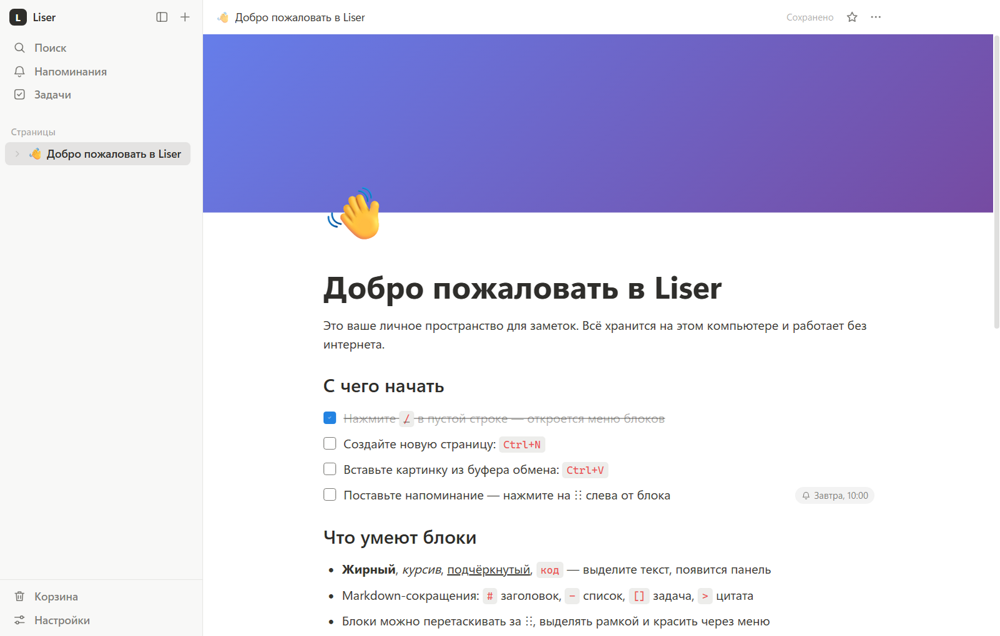

<p align="center">
  
</p>

<h1 align="center">Liser</h1>

<p align="center">
  Офлайн-заметки для Windows: блоки, задачи, напоминания и рисование.<br>
  Всё хранится только на вашем компьютере.
</p>

<p align="center">
  <b>Русский</b> · <a href="README.en.md">English</a>
</p>



## Возможности

- **Блочный редактор**: текст, заголовки, списки задач, маркированные и нумерованные списки, раскрывающиеся списки, цитаты, выноски, код, разделители, картинки, рисунки и вложенные страницы.
- **Меню `/`** и Markdown-сокращения: `#` заголовок, `-` список, `[]` задача, `>` цитата, `>>` раскрывающийся список, ```` ``` ```` код.
- **Напоминания** с датой и временем, повтором (каждый день / неделю / месяц / год), системными уведомлениями Windows и кнопкой «Отложить». Работают в фоне из трея.
- **Связи между страницами**: выделите слово и нажмите «Страница» на панели (`Ctrl+Shift+K`) или наберите `[[`. При наведении на ссылку видно превью страницы, а внизу каждой страницы есть список ссылок на неё и упоминаний без ссылки.
- **Граф** (`Ctrl+G`): карта всех страниц и связей между ними. Можно масштабировать, двигать, искать и открыть граф отдельной страницы.
- **Задачи** со всех страниц на одном экране, **напоминания** сгруппированы по срокам.
- **Рисование** пером, маркером и ластиком; можно рисовать поверх картинки. Штрихи хранятся векторно и не теряют чёткости при масштабе.
- **Картинки**: вставка из буфера `Ctrl+V`, перетаскивание файлов, изменение размера, подписи.
- **Оформление**: обложки, иконки страниц, цвета текста и фона блоков, три шрифта, режим «во всю ширину».
- **Поиск** по всем заметкам (`Ctrl+P`) и по странице (`Ctrl+F`).
- **Темы** светлая, тёмная и системная, 7 акцентных цветов, масштаб интерфейса.
- **Языки**: русский, английский и иврит с зеркальным интерфейсом справа налево. Направление текста определяется для каждого абзаца, поэтому заметки на разных языках можно смешивать.
- **Данные**: автосохранение, ежедневные автоматические копии, ручная резервная копия и восстановление, экспорт в Markdown и PDF.

## Установка

Скачайте `Liser-Setup-<версия>.exe` в разделе [Releases](../../releases) и запустите. Установщик спросит папку, создаст ярлыки на рабочем столе и в меню «Пуск». Удаление — через «Параметры → Приложения».

**Обновление**: просто запустите установщик новой версии. Он сам найдёт установленный Liser, покажет, какая версия стоит и какая будет, и предложит кнопку «Обновить». Программа обновится в той же папке, заметки и настройки не затрагиваются.

> Установщик не подписан сертификатом разработчика, поэтому при первом запуске Windows SmartScreen может показать предупреждение: «Подробнее → Выполнить в любом случае».

Заметки лежат в `%APPDATA%\Liser\data` — каждая страница отдельным JSON-файлом, картинки рядом в папке `assets`.

## Горячие клавиши

| Клавиши | Действие |
| --- | --- |
| `Ctrl+N` | Новая страница |
| `Ctrl+P` / `Ctrl+F` | Поиск по заметкам / по странице |
| `Ctrl+S` | Сохранить сейчас |
| `Ctrl+Z` / `Ctrl+Y` | Отменить / повторить |
| `Ctrl+B` / `I` / `U` / `E` / `K` | Жирный / курсив / подчёркнутый / код / ссылка |
| `Ctrl+Shift+K` / `[[` | Ссылка на страницу |
| `Ctrl+G` | Граф связей |
| `Ctrl+D` | Дублировать блок |
| `Ctrl+Enter` | Отметить задачу или раскрыть список |
| `Ctrl+Shift+↑/↓` | Переместить блок |
| `Tab` / `Shift+Tab` | Отступ |
| `Ctrl+\` | Скрыть боковую панель |
| `Ctrl+,` | Настройки |
| `Ctrl` + `+` / `−` / `0` | Масштаб |

Клавиши привязаны к физическим кнопкам, поэтому работают в любой раскладке.

## Разработка

Нужен [Node.js](https://nodejs.org) 20 или новее.

```bash
npm install
npm start            # запустить приложение
npm run web          # открыть интерфейс в браузере (данные в localStorage)
npm run check        # проверка синтаксиса и полноты переводов
npm run dist         # собрать установщик в папку dist
```

Сборка в GitHub Actions запускается на каждый push; при пуше тега `v*` установщик публикуется в Releases.

### Устройство

```
src/
  main.js            главный процесс: окно, трей, хранилище, напоминания, копии, экспорт
  preload.js         безопасный мост между окном и главным процессом
  renderer/
    index.html
    css/app.css      все стили, светлая и тёмная темы, RTL, печать
    js/app.js        запуск, навигация, верхняя панель, горячие клавиши
    js/editor.js     блочный редактор
    js/store.js      данные, автосохранение, поиск
    js/i18n.js       переводы ru / en / he
    js/…             боковая панель, экраны, холст, поиск по странице, интерфейсные элементы
```

Интерфейс написан на чистом JavaScript без фреймворков и сборщика: модули загружаются напрямую, поэтому окно открывается быстро, а установщик содержит только сам Electron и исходники.

## Лицензия

[MIT](LICENSE)
