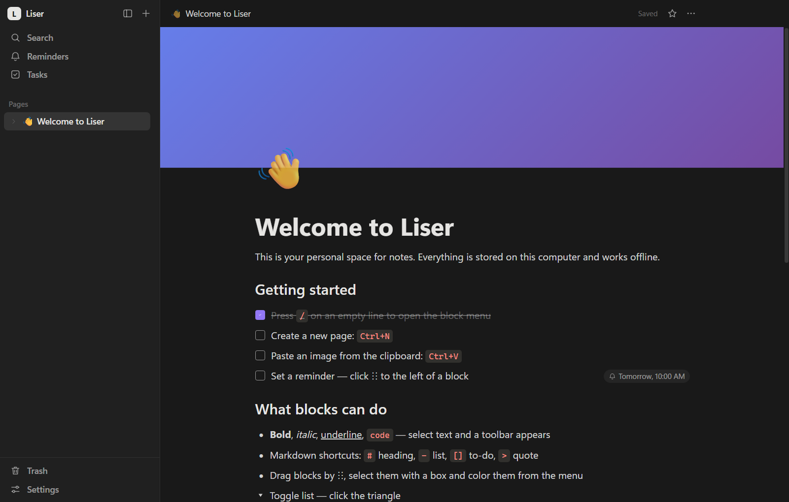
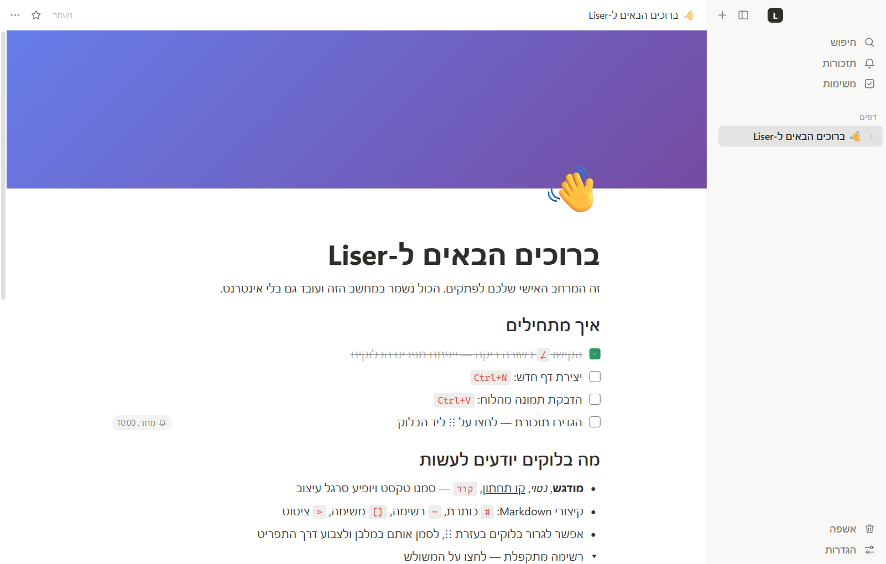

<p align="center">
  
</p>

<h1 align="center">Liser</h1>

<p align="center">
  Offline notes for Windows: blocks, to-dos, tables, code, reminders and drawing.<br>
  Everything stays on your computer.
</p>

<p align="center">
  <b>English</b> · <a href="README.he.md">עברית</a> · <a href="README.ru.md">Русский</a>
</p>

<p align="center">
  <a href="https://github.com/polkakoch/liser/releases/latest/download/Liser-Setup.exe"><b>⬇ Download Liser for Windows</b></a>
</p>



## Features

- **Block editor**: text, headings, to-do lists, bulleted and numbered lists, toggle lists, quotes, callouts, code, tables, dividers, images, drawings, a table of contents and nested pages.
- **`/` menu** and Markdown shortcuts: `#` heading, `-` list, `[]` to-do, `>` quote, `>>` toggle, ```` ``` ```` code — plus Markdown as you type: `**bold**`, `*italic*`, `` `code` ``, `~~strikethrough~~`.
- **Code** with syntax highlighting for 22 languages. The language is detected automatically or picked by hand, a pasted piece of code turns into a code block right away, and there's a Copy button.
- **Tables and vocabulary**: `/table`, or `/vocabulary` for a ready “Word — Translation” table for learning languages. `Tab` moves to the next cell, `Enter` adds a row, columns can be sorted and resized, and every cell picks its own text direction. Lists copied from Excel or Google Sheets paste straight in as a table.
- **Linked pages**: select a word and press “Page” on the toolbar (`Ctrl+Shift+K`), or type `[[` or `@`. Hovering a link previews the page, and each page lists its backlinks and unlinked mentions at the bottom.
- **Graph view** (`Ctrl+G`): a map of all pages and the links between them, with zoom, pan, search and a per-page local graph.
- **Reminders** with date, time and repeat (daily / weekly / monthly / yearly), native Windows notifications and snooze. They keep working from the tray.
- **Tasks** from every page in one view; **reminders** grouped by due date.
- **Drawing** with pen, highlighter and eraser, including on top of images. Strokes are vector, so they stay sharp at any zoom.
- **Images**: paste with `Ctrl+V`, drag & drop, resize, captions.
- **Styling**: covers, page icons, block text and background colors, three fonts, full-width pages.
- **Search** across all notes (`Ctrl+P`) and within a page (`Ctrl+F`).
- **Themes**: light, dark and system, 7 accent colors, interface zoom from 50 % to 200 %.
- **Languages**: English, Hebrew and Russian with a fully mirrored right-to-left interface. Text direction is detected per paragraph, so notes can mix languages.
- **Your data**: autosave, daily automatic backups, manual backup and restore, export to Markdown and PDF.



## Install

[Download the installer](https://github.com/polkakoch/liser/releases/latest/download/Liser-Setup.exe) (always the latest version) and run it. Older versions are in [Releases](../../releases). The installer lets you pick a folder and creates desktop and Start menu shortcuts. Uninstall from Settings → Apps.

**Updating**: just run the newer installer. It detects the installed version, shows old → new, and offers an “Update” button. The app is updated in place; notes and settings are untouched.

> The installer isn't code-signed, so Windows SmartScreen may warn on first run: “More info → Run anyway”.

Notes are stored in `%APPDATA%\Liser\data` — one JSON file per page, images in the `assets` folder next to them.

## Keyboard shortcuts

| Keys | Action |
| --- | --- |
| `Ctrl+N` | New page |
| `Ctrl+P` / `Ctrl+F` | Search all notes / find in page |
| `Ctrl+S` | Save now |
| `Ctrl+Z` / `Ctrl+Y` | Undo / redo |
| `Ctrl+B` / `I` / `U` / `E` / `K` | Bold / italic / underline / code / link |
| `Ctrl+Shift+K` / `[[` / `@` | Link to a page |
| `Ctrl+G` | Graph view |
| `Ctrl+Shift+0…9` | Turn into: text, headings 1–3, to-do, lists, toggle, code, quote |
| `Ctrl+/` | Block menu |
| `Tab` / `Enter` / `Ctrl+Enter` | In a table: next cell / new row / leave the table |
| `Ctrl+D` | Duplicate block |
| `Ctrl+Enter` | Check a to-do or open a toggle |
| `Ctrl+Shift+↑/↓` | Move block |
| `Tab` / `Shift+Tab` | Indent / outdent |
| `Ctrl+\` | Hide the sidebar |
| `Ctrl+,` | Settings |
| `Ctrl` + `+` / `−` / `0` | Zoom in / out / reset |

Shortcuts are bound to physical keys, so they work in any keyboard layout.

## Development

Requires [Node.js](https://nodejs.org) 20+.

```bash
npm install
npm start            # run the app
npm run web          # open the UI in a browser (data in localStorage)
npm run check        # syntax and translation completeness check
npm run dist         # build the installer into dist/
npm run dist:beta    # build "Liser Beta" into beta/ (installs separately, with its own data)
```

GitHub Actions builds on every push; pushing a `v*` tag publishes the installer to Releases.

### Project layout

```
src/
  main.js            main process: window, tray, storage, reminders, backups, export
  preload.js         safe bridge between the window and the main process
  renderer/
    index.html
    css/app.css      all styles: light and dark themes, RTL, print
    js/app.js        startup, navigation, top bar, shortcuts, zoom
    js/editor.js     block editor
    js/table.js      tables
    js/codehl.js     code highlighting and language detection
    js/store.js      data, autosave, search, links
    js/i18n.js       translations en / he / ru
    js/…             sidebar, views, graph, drawing, find in page, UI widgets
```

The UI is plain JavaScript with no framework or bundler: modules load directly, so the window opens fast and the installer contains only Electron plus the sources.

## License

[MIT](LICENSE)
